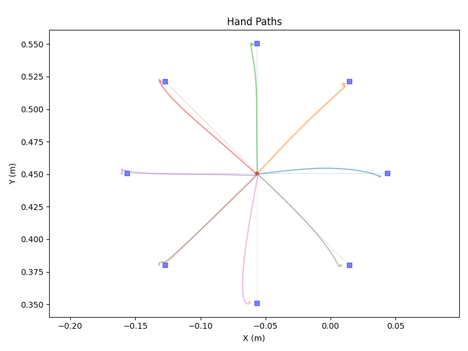
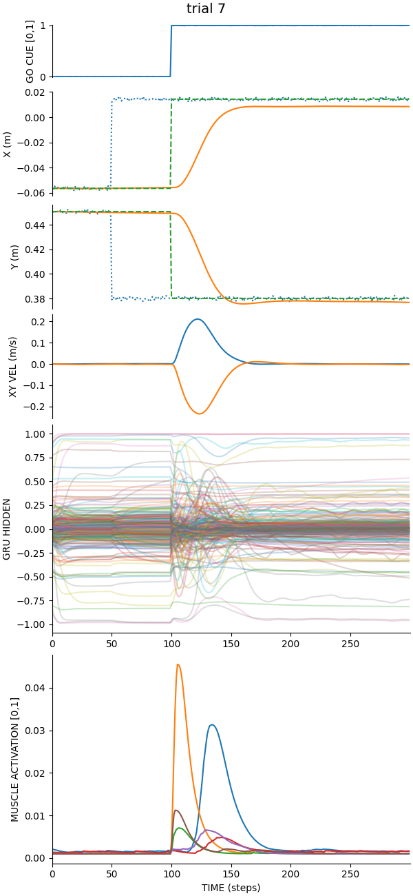

# motornet_demo

## demo1.py
simple demo of training a motornet system

- two joint planar arm (shoulder, elbow)
- 6 Hill-type muscles based on Kistemaker, Wong & Gribble (2010) J. Neurophysiol. 104(6):2985-94
- training on point-to-point reaches to random targets in the workspace
- null-field training by default though curl FFs are an option
- center-out reaches to 'test' the network
- various plots

## Installing motornet

Assumption: you have python3.12 and the [uv](https://docs.astral.sh/uv/) python package manager installed.

On MacOS use the [Homebrew](https://brew.sh) package manager:

```{shell}
brew install python@3.12 uv
```

Then a one-time setup for motornet_demo:

```{shell}
bash setup.sh
```

## Starting point

After you setup as above, you can run the `demo1.py` script like this:

```{shell}
uv run python demo1.py
```

## Code layout

| file | what it is |
|---|---|
| `demo1.py` | start here: trains a plain GRU step by step, then tests it |
| `go_1module.py` ... `go_4module.py` | train modular networks (1 to 4 "brain areas") |
| `reaching_model.py` | `ReachingModel`: create / train / test / save / load a modular network |
| `my_env.py` | the environment: what the network senses |
| `my_task.py` | the task: what trials look like (targets, go cue, catch trials) |
| `my_policy.py` | the networks: `PolicyGRU` and `ModularPolicyGRU` |
| `my_loss.py` | the loss functions |
| `my_utils.py` | `run_episode` (simulate a batch of trials), saving and loading |
| `fast_rollout.py` | a faster, equivalent `run_episode` for long training runs: `model.train(..., fast=True)` |
| `check_fast_rollout.py` | checks that `fast_rollout.py` and `run_episode` still agree |
| `my_plots.py` | plots of losses, hand paths and single-trial signals |
| `demo1_visualize.ipynb`, `visualize_modular.ipynb` | load a trained model and analyse its activity |
| `motornet/` | the arm and muscle simulation library |

To extend: a new task goes in `my_task.py`, a new loss in `my_loss.py`, a new
architecture is a new `go_*.py` script.

## Parallel computing on Apple Silicon

Doing `brew install libomp` will help make things stable when doing parallel training especially with compile directives.

## Example Results




